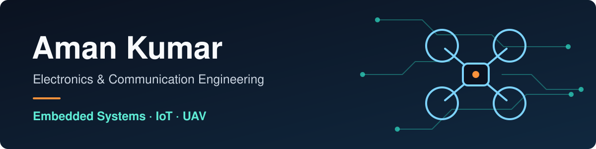

  

  
  
  

## About me

I am a B.Tech student in **Electronics & Communication Engineering** at JIET Group of Institutions, Jodhpur (CGPA 8.5). I build hardware-and-software projects with **ESP32, Arduino, ATmega32 and Raspberry Pi**, and I work with drone systems.

- 📍 Based in Delhi, India
- 🛠️ Focus: embedded systems, IoT, sensor interfacing and PCB design
- 🚁 UAV exposure: Pixhawk, ArduPilot / PX4, GPS, IMU, telemetry and flight-data analysis
- 🌱 Interested in: battery management systems and electric-vehicle technology
- 💡 Exploring an idea: AI-powered smart glasses
- 🤝 Open to collaborating on electronics, embedded and IoT projects

## Tech stack

**Programming** 

**Boards and protocols** 

**UAV** 

**Design and tools** 

## Featured projects

| Project | What it does | Built with |
|---|---|---|
| **Self-balancing robot** | Two-wheeled robot that keeps itself upright with IMU tilt sensing, a complementary filter and PID control. A Wi-Fi web dashboard gives live camera video, telemetry and remote control. | ESP32-CAM, MPU6500, L298N, C++, PlatformIO |
| [**ECG patient health monitoring**](https://github.com/Amankumar0510/ECG-Patient-Health-Monitoring) | Reads ECG signal values, uploads them to the cloud for visualisation and emails a PDF report. | Raspberry Pi, ADS1115, Python, ThingSpeak, MATLAB |
| [**Wireless charger system**](https://github.com/Amankumar0510/Wireless-Charger-System) | Power-transfer circuit with tuned LC stages, rectification and filtering, studied in simulation and on hardware. | LC circuits, BAT54 diodes, Proteus |
| **Home automation** | Microcontroller-based control and monitoring of lights and appliances. | ATmega32 |
| **Portable GPS tracker** | Pocket-sized safety device that sends live location to an app or dashboard. | ESP32, GPS |
| **Smart dustbin** | Sensor-operated lid with obstacle detection and fill-level monitoring. | Arduino |

## Experience

| Role | Organisation | Period |
|---|---|---|
| Drone / UAV Engineering Intern | UAV engineering internship | Sep 2026 – Present |
| Product R&D Management Executive | PBL Ventures (Crazinos), Noida | Apr 2026 – Aug 2026 |
| Signal & Telecommunication Intern | Indian Railways, East Central Railway, Hajipur | Jun 2025 – Jul 2025 |

## Certifications and leadership

- **Certifications:** C Programming and NI Multisim Circuit Designing (Infosys), IoT Edge Computing and IoT Analytics (Infosys), MATLAB & Simulink, Embedded Systems and VLSI courses (NIELIT), Arduino and IoT Programming (Alison)
- **Programmes:** IEEE EDS Summer School and IEEE CASS programme on neuromorphic and edge AI computing, IIT Jodhpur
- **Leadership:** President, Electronics & Communication Engineering Student Council
